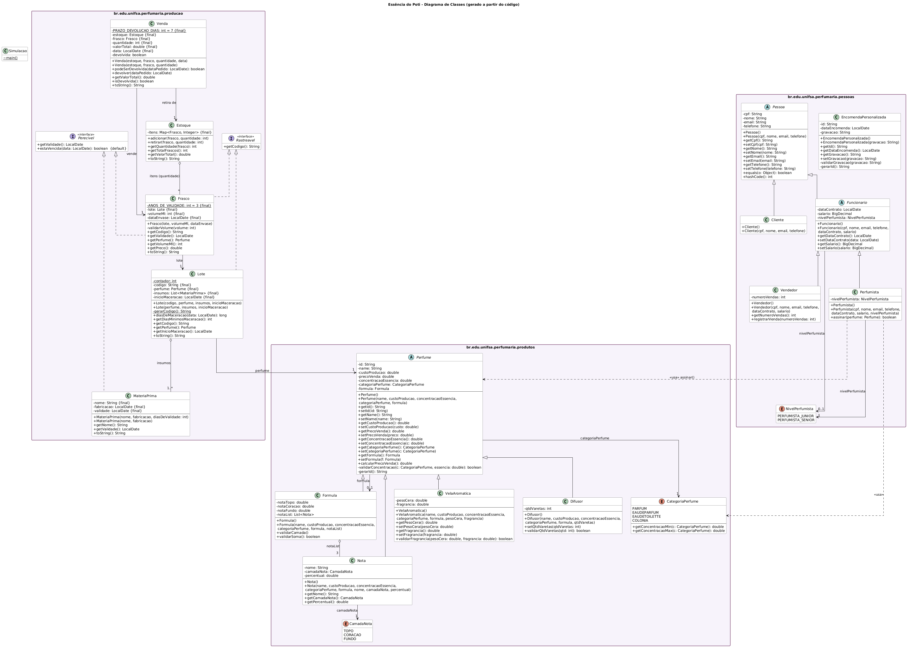

# Essência do Poti - Projeto de POO

Sistema da perfumaria artesanal Essência do Poti (Teresina), feito para a disciplina de Programação Orientada a Objetos (UNIFSA).

## Integrantes

| Nome | Usuário do GitHub | Módulo |
|---|---|---|
| Neto | [R-SNeto](https://github.com/R-SNeto) | `produtos` e `pessoas` |
| Cadu Portela | [carlosportela-bp](https://github.com/carlosportela-bp) | `producao` |
| Carlos Araújo | [carlosaraujo](https://github.com/carjkls) | `simulacao` |

## Como executar

A classe principal é `br.edu.unifsa.perfumaria.Simulacao`. Ela roda o roteiro de um dia na perfumaria e mostra no console cada regra de negócio sendo testada.

## Organização

```
src/main/java/br/edu/unifsa/perfumaria/
├── Simulacao.java
├── produtos/   Perfume (abstrata), VelaAromatica, Difusor, Formula, Nota, CategoriaPerfume, CamadaNota
├── producao/   Rastreavel, Perecivel, MateriaPrima, Lote, Frasco, Estoque, Venda
└── pessoas/    Pessoa (abstrata), Funcionario (abstrata), Perfumista, Vendedor, Cliente, EncomendaPersonalizada, NivelPerfumista
```

## Decisões de modelagem

### producao

- **MateriaPrima**: óleos e álcool usados na produção. Guarda nome, fabricação e validade, e sabe dizer se está vencida.
- **Lote**: cada produção gera um lote com código próprio, o perfume produzido, as matérias-primas usadas e a data de início da maceração. É no lote que ficam a RN05 (código definido na criação e nunca alterado) e a RN08 (matéria-prima vencida não entra na produção).
- **Frasco**: representa o envase. Criar um frasco é envasar um lote, por isso a RN04 (maceração mínima por categoria) é conferida no construtor. O volume só pode ser 30, 50 ou 100 ml e não muda depois (RN03).
- **Estoque**: guarda quantos frascos de cada envase existem. A retirada nunca deixa a quantidade negativa (RN07).
- **Venda**: retira os frascos do estoque ao ser criada. Aceita devolução em até 7 dias e não vende frasco vencido.

### produtos e pessoas

- **Perfume** é a superclasse dos itens produzidos. A categoria (Parfum, EDP, EDT, Colônia) fica no enum `CategoriaPerfume`, que guarda as faixas de concentração da RN01.
- **Pessoa** reúne os dados comuns a clientes e funcionários (CPF, nome, e-mail, telefone). **Funcionario** acrescenta contrato e salário, e se divide em **Perfumista** (com nível júnior ou sênior, usado na RN09) e **Vendedor**.

## Modificadores de acesso

- **Todos os atributos são `private`.** Nenhuma classe acessa os dados de outra diretamente; tudo passa por métodos que validam as regras.
- **Atributos `final` sem setter**: `Lote.codigo` (RN05), `Frasco.volumeMl` (RN03) e as datas de `MateriaPrima` e `Venda`. São definidos só no construtor, porque o negócio não permite que mudem.
- **Métodos `private` auxiliares**: `Frasco.validarVolume()`, `Lote.gerarCodigo()`, `Perfume.validarConcentracao()`, `EncomendaPersonalizada.validarGravacao()`. Só servem para a própria classe validar ou calcular, então não precisam ser vistos de fora.
- **Getters e setters só onde fazem sentido**: no módulo producao não existe nenhum setter. Lotes, frascos e vendas não mudam depois de criados; a única mudança de estado é a devolução, feita pelo método `devolver()`, que valida o prazo.

## Classes abstratas

- **Perfume**: não existe "perfume genérico" na loja; todo item produzido é de um tipo concreto.
- **Pessoa**: ninguém é só "pessoa" no sistema; é sempre cliente ou funcionário.
- **Funcionario**: todo funcionário tem um cargo concreto (perfumista ou vendedor).

## Interfaces

- **Rastreavel** (`getCodigo()`): capacidade de ser rastreado até o lote de produção. Implementada por `Lote` e `Frasco`, que não têm relação de herança.
- **Perecivel** (`getValidade()`, `estaVencida()`): capacidade de ter prazo de validade. Implementada por `MateriaPrima` e `Frasco`, que também não são parentes. O método `estaVencida()` é `default`, então fica escrito uma vez só na interface e serve para as duas classes. É usado na RN08 (o lote recusa matéria-prima vencida) e na venda (não vende frasco vencido).
- **Frasco implementa as duas interfaces**: ele é rastreável (vem de um lote) e perecível (tem validade de 3 anos após o envase).

## Regras de negócio

| Regra | Onde é garantida |
|---|---|
| RN01 concentração por categoria | `Perfume` / `CategoriaPerfume` |
| RN02 notas somam 100% | `Formula` |
| RN03 frascos de 30, 50 ou 100 ml | construtor de `Frasco` |
| RN04 maceração mínima | construtor de `Frasco` + `Lote.getDiasMinimosMaceracao()` |
| RN05 código do lote imutável | construtor de `Lote` (sem setter) |
| RN06 preço mínimo | `Perfume.calcularPrecoVenda()` |
| RN07 estoque nunca negativo | `Estoque.retirar()` |
| RN08 matéria-prima vencida | construtor de `Lote` |
| RN09 júnior não assina Parfum | `Perfumista.assinar()` |
| RN10 vela e difusor | `VelaAromatica` e `Difusor` |
| RN11 gravação de até 20 caracteres | `EncomendaPersonalizada` |

## Digrama de Classes


